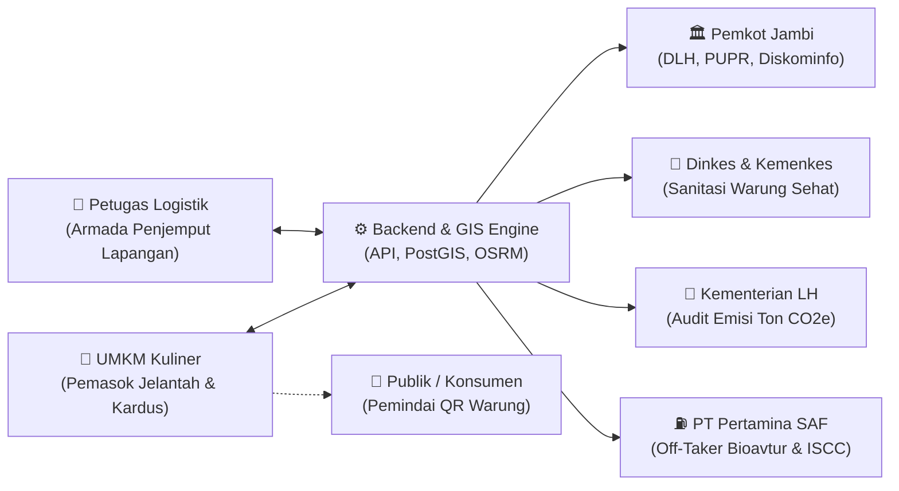
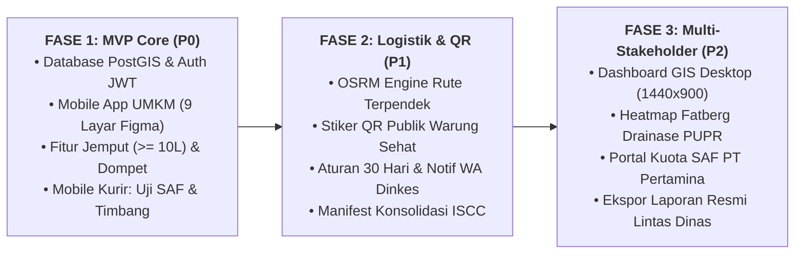

# PRODUCT REQUIREMENTS DOCUMENT (PRD) FINAL
# SISTEM INFORMASI EKOSISTEM SIKLUSJAMBI

> **Kode Proyek:** SIGINJAI-SIKLUSJAMBI  
> **Versi Dokumen:** 2.0 (Final Architecture & Workflow Alignment)  
> **Status:** Disetujui & Siap Implementasi  
> **Target Wilayah:** 11 Kecamatan, Kota Jambi  
> **Off-Taker Hilir:** Depot Bioavtur (SAF) PT Pertamina & Sertifikasi ISCC  

---

## 1. Ringkasan Eksekutif & Visi Produk

**SiklusJambi** adalah platform ekonomi sirkular berbasis geospasial (*Geo-Circular Economy*) yang mengintegrasikan rantai pasok pengumpulan limbah minyak jelantah (*Used Cooking Oil* / UCO) dan limbah kardus dari pelaku UMKM kuliner di Kota Jambi. 

Platform ini mentransformasi limbah berbahaya pemicu penyumbatan drainase (*fatberg*) dan pencemaran Sungai Batanghari menjadi bahan baku energi terbarukan bernilai tinggi: **Sustainable Aviation Fuel (SAF / Bioavtur)** yang diserap oleh **PT Pertamina**.

Sistem ini didukung oleh infrastruktur aplikasi mobile multi-aktor, engine optimasi rute (*OSRM*), basis data spasial (*PostGIS*), serta dashboard analitik desktop command center (*1440x900*) untuk multi-stakeholder (Pemkot Jambi, Dinkes, KLH, dan PT Pertamina).

---

## 2. Pemangku Kepentingan & Persona Aktor

| ID Aktor | Nama Peran | Platform Akses | Tanggung Jawab & Hak Akses Utama |
|---|---|---|---|
| **ACT-01** | **Pelaku Kuliner UMKM** | Mobile App (Android/PWA) | Registrasi usaha, set titik GPS, request jemput ($\ge 10\text{L}$), pantau status, terima saldo instan & poin, unduh QR Warung Sehat. |
| **ACT-02** | **Petugas Logistik** | Mobile App (Khusus Kurir) | Aktivasi zona tugas, terima rute OSRM, uji mutu 3 syarat SAF, timbang digital, foto bukti, konsolidasi ke tangki armada. |
| **ACT-03** | **Admin Pemkot (DLH/PUPR)** | Web Desktop (1440x900) | Pantau heatmap serapan jelantah 11 kecamatan, analisis titik rawan fatberg/banjir 30 RT, kelola harga harian & katalog reward. |
| **ACT-04** | **Dinkes & Kemenkes** | Web Desktop (1440x900) | Audit kepatuhan stiker Warung Sehat, pemantauan warung pasif $>30\text{ hari}$, pengiriman peringatan WA & jadwal inspeksi higienitas. |
| **ACT-05** | **Kementerian Lingkungan Hidup** | Web Desktop (1440x900) | Audit indeks serapan limbah DAS Sungai Batanghari, verifikasi kalkulasi dekarbonisasi nasional ($\text{Ton }\mathrm{CO_2e}$). |
| **ACT-06** | **PT Pertamina (Proyek SAF)** | Web Desktop & QR Scanner | Verifikasi penerimaan muatan tangki konsolidasi, audit QR Manifest ISCC untuk *traceability* asal-usul warung hingga kilang bioavtur. |
| **ACT-07** | **Publik / Konsumen** | Web Publik (Mobile View) | Memindai stiker QR fisik di warung makan untuk memverifikasi keaslian sertifikat bebas minyak jelantah berulang. |

---

## 3. Spesifikasi Kebutuhan Fungsional (Functional Requirements)

### 3.1 Modul UMKM & Registrasi (FR-01 s/d FR-03)
* **FR-01: Registrasi 4 Langkah & Geolokasi PostGIS**
  * *Input:* Nama lengkap, No. WhatsApp, persetujuan domisili Kota Jambi & S&K.
  * *Verifikasi:* OTP 4-digit via WhatsApp Gateway resmi.
  * *Kredensial:* Pembuatan kata sandi aman (enkripsi bcrypt) + sesi JWT.
  * *Profil Usaha:* Pemilihan kecamatan (11 kecamatan), estimasi pemakaian minyak (L/hari), unggah foto fisik warung, dan penentuan titik koordinat GPS presisi yang disimpan dalam tipe spasial `GEOMETRY(Point, 4326)` PostGIS.
* **FR-02: Katalog Harga Transparan & Edukasi Limbah**
  * Tampilan indeks harga dinamis per liter (misal: Rp7.500/L) dan harga limbah kardus per kg.
  * Fitur simulasi pendapatan dan menu informasi dampak lingkungan (*Dampak Kita*).
* **FR-03: Permintaan Penjemputan 1-Tap (Minimum 10 Liter)**
  * Pelaku usaha dapat meminta penjemputan dengan satu ketukan tombol *"Jemput Limbah Saya"*.
  * Validasi mutlak: Volume input $\ge 10\text{ Liter}$. Jika $< 10\text{L}$, sistem menolak pengajuan dengan pesan edukasi batas minimal efisiensi logistik.

### 3.2 Modul Logistik, Rute & Quality Control SAF (FR-04 s/d FR-06)
* **FR-04: Antrean Order & Optimasi Rute GIS (OSRM Engine)**
  * Sistem otomatis mengelompokkan order warung searah dalam satu klaster kecamatan.
  * OSRM API menghitung matriks jarak dan rute navigasi terpendek untuk armada kurir.
* **FR-05: Quality Control (QC) Fisik Standar SAF Pertamina**
  * Petugas wajib memeriksa **3 Syarat Mutu Fisik**:
    1. Bebas kandungan air (tidak keruh/memisah).
    2. Bebas endapan padat remahan tepung/arang gosong.
    3. Murni minyak jelantah nabati (UCO).
  * **Alur Penolakan & Edukasi:** Jika minyak tidak lolos, petugas mencatat alasan di aplikasi. Sistem seketika mengirimkan notifikasi edukasi ke WhatsApp pemilik warung berisi instruksi penyaringan ulang sebelum mengajukan jemputan kembali.
* **FR-06: Timbang Digital & Bukti Foto Lapangan**
  * Petugas memasukkan volume liter riil hasil timbangan di hadapan pemilik warung.
  * Pengambilan foto bukti fisik jerigen di atas timbangan menggunakan kamera aplikasi *(geotagged & timestamped)*.

### 3.3 Modul Dompet, Poin & Transaksi (FR-07 s/d FR-08)
* **FR-07: Kredit Instan Saldo & Poin Reward (Idempoten)**
  * Begitu petugas klik konfirmasi transaksi:
    $$\text{Saldo Masuk} = \text{Volume (Liter)} \times \text{Harga per Liter}$$
    $$\text{Poin Bertambah} = 1 \text{ Poin} \times \text{Volume (Liter)}$$
  * Transaksi dieksekusi dalam database transaction berisolasi ACID dengan `idempotency_key` untuk mencegah kredit ganda saat jaringan tidak stabil.
  * Notifikasi instan diterima UMKM dalam waktu $< 3\text{ detik}$.
* **FR-08: Transfer Saldo & Penukaran Katalog Hadiah**
  * Penarikan saldo ke rekening bank / e-wallet terdaftar.
  * Penukaran poin reward dengan merchandise, peralatan masak, atau voucher sembako.

### 3.4 Modul Sertifikasi Stiker QR "Warung Sehat" (FR-09)
* **FR-09: Siklus Hidup Sertifikat & Intervensi Dinkes (Aturan 30 Hari)**
  * Warung yang menyetor jelantah aktif mendapatkan stiker QR "Warung Sehat Kota Jambi".
  * **Masa Berlaku:** Tepat 30 hari kalender sejak tanggal transaksi terakhir yang valid.
  * **Pembaruan Otomatis:** Jika warung menyetor kembali sebelum 30 hari, masa berlaku otomatis diperpanjang 30 hari berikutnya.
  * **Sanksi Keterlambatan ($> 30\text{ Hari}$):**
    1. Status stiker QR otomatis berubah menjadi `Nonaktif / Kedaluwarsa`.
    2. Bot WhatsApp mengirim peringatan resmi ke pemilik warung.
    3. Profil warung otomatis masuk antrean pembinaan higienitas & inspeksi lapangan Dinas Kesehatan Kota Jambi.
  * **Halaman Publik QR:** Saat konsumen memindai stiker warung, halaman publik memvalidasi keaslian, nama warung, tanggal setoran terakhir, dan total liter jelantah yang diselamatkan tanpa membocorkan data finansial pribadi.

### 3.5 Modul Manifest Konsolidasi & Audit ISCC PT Pertamina (FR-10)
* **FR-10: Manifest Harian & Ketertelusuran Rantai Pasok (*Traceability*)**
  * Setelah mengumpulkan jelantah harian (misal: 215,5 L dari 12 warung), armada menuju Depot Konsolidasi Pertamina.
  * Sistem menerbitkan **ID Manifest Unik** (contoh: `MNF-SAF-04`) berformat QR Code digital yang memuat:
    * Rekap volume total liter dan berat jenis.
    * Daftar geolokasi dan identitas warung asal limbah.
    * Tanggal dan jam penjemputan.
  * Petugas Depot PT Pertamina memindai QR Manifest untuk mencocokkan muatan tangki armada dengan data rantai pasok kepatuhan **ISCC** *(International Sustainability and Carbon Certification)*.

### 3.6 Modul Multi-Stakeholder Dashboard Command Center (FR-11 s/d FR-14)
* **FR-11: Heatmap Spasial 11 Kecamatan & Mitigasi Fatberg PUPR/DLH**
  * Visualisasi peta poligon 11 kecamatan Kota Jambi dengan intensitas warna serapan jelantah.
  * Layer monitoring drainase pada **30 RT rawan genangan/banjir** akibat tumpukan lemak beku (*fatberg*).
* **FR-12: Kalkulator Dekarbonisasi KLH & Sungai Batanghari**
  * Perhitungan metrik ekologis otomatis:
    $$\text{Pencegahan Pencemaran Air} = \text{Volume Jelantah (L)} \times 1.000 \text{ Liter Air Bersih}$$
    $$\text{Reduksi Emisi GRK} = \text{Volume Jelantah (L)} \times \text{Faktor Emisi Bioavtur} \; (\text{Ton }\mathrm{CO_2e})$$
* **FR-13: Monitoring Kuota Bahan Baku Bioavtur PT Pertamina**
  * Pelacakan persentase realisasi kuota bulanan pasokan bahan baku SAF.
* **FR-14: Ekspor Laporan Resmi Multi-Instansi**
  * Ekspor dokumen pelaporan format PDF bertanda tangan digital dan CSV untuk bahan audit Smart City Pemkot Jambi, Kemenkes, KLH, dan Pertamina.

---

## 4. Kebutuhan Nonfungsional (Non-Functional Requirements)

1. **Performa & Responsivitas:**
   * Waktu muat layar awal aplikasi mobile $\le 2\text{ detik}$.
   * Proses pembukuan saldo dan notifikasi penjemputan $\le 3\text{ detik}$.
   * Query spasial PostGIS untuk rute dan heatmap di-render dalam waktu $\le 1{,}5\text{ detik}$.
2. **Keamanan & Integritas Data:**
   * Komunikasi jaringan wajib HTTPS dengan sertifikat TLS 1.3.
   * Autentikasi API berbasis stateless JSON Web Token (JWT) dengan refresh token berputar.
   * Seluruh kata sandi di-hash menggunakan algoritma Argon2id atau Bcrypt.
   * Mekanisme *Rate Limiting* pada endpoint OTP WhatsApp untuk mencegah spam / brute force.
3. **Ketersediaan Offline (Offline-First Resiliency):**
   * Aplikasi mobile logistik dilengkapi cache lokal (SQLite / IndexedDB) agar kurir tetap dapat mencatat data penimbangan di titik blank-spot sinyal, yang otomatis tersinkronisasi saat kembali online (*eventual consistency*).
4. **Skalabilitas:**
   * Basis data dan arsitektur backend dirancang sanggup menampung $\ge 10.000$ mitra UMKM kuliner aktif dan ribuan transaksi harian di Kota Jambi dan sekitarnya.
5. **Kompatibilitas:**
   * Mobile: Ringan ($< 25\text{ MB}$), mendukung Android 8.0+ dan peramban web modern (PWA).
   * Web Dashboard: Dioptimalkan untuk resolusi desktop minimum $1440 \times 900\text{ piksel}$.

---

## 5. Matriks Aturan Bisnis Inti (Business Rules)

| Kode | Aturan Bisnis | Konsekuensi Pelanggaran |
|---|---|---|
| **BR-01** | Minimum pengajuan penjemputan jelantah adalah **10 Liter**. | Form pengajuan ditolak sistem; tombol submit terkunci. |
| **BR-02** | Nilai perolehan reward poin adalah **1 Poin per 1 Liter** minyak jelantah lolos uji. | Dihitung otomatis; pembulatan matematis ke bawah untuk pecahan desimal. |
| **BR-03** | Standar uji fisik SAF: Bebas air, bebas endapan, murni UCO. | Tolak di tempat; batalkan penimbangan; terbitkan notifikasi edukasi saring ulang. |
| **BR-04** | Validitas stiker QR Warung Sehat adalah **30 Hari Kalender** sejak setoran sah terakhir. | Jika $>30\text{ hari}$, QR publik nonaktif dan data diteruskan ke Dinkes untuk inspeksi. |
| **BR-05** | Alokasi penugasan kurir dibatasi per zona kecamatan aktif armada. | Kurir hanya melihat antrean penjemputan dalam radius operasional yang ditentukan. |
| **BR-06** | Setiap batch muatan armada ke Pertamina wajib memiliki ID Manifest digital terverifikasi. | Depot Pertamina menolak muatan tangki tanpa QR Manifest ISCC resmi. |

---

## 6. Contoh Kriteria Penerimaan (Acceptance Criteria)

### Kasus 1: Permintaan Penjemputan UMKM (FR-03)
* **Given** UMKM login dan berada di wilayah Kota Jambi dengan profil GPS valid.
* **When** UMKM memasukkan volume 15 liter dan menekan *"Jemput Limbah Saya"*.
* **Then** Sistem membuat nomor tiket order, mengubah status menjadi *"Proses Penjemputan"*, dan menampilkan estimasi penugasan di tab *Jadwal Jemputan*.
* **When** UMKM mencoba memasukkan volume 7 liter.
* **Then** Sistem menampilkan notifikasi error: *"Batas minimum penjemputan adalah 10 Liter"* dan tiket tidak dibuat.

### Kasus 2: Uji Mutu Fisik SAF oleh Kurir (FR-05)
* **Given** Kurir tiba di lokasi UMKM dan melakukan inspeksi fisik minyak jelantah.
* **When** Minyak terbukti mengandung air atau endapan arang tebal, lalu kurir menekan *"Tidak Lolos Standar SAF"*.
* **Then** Status order berubah menjadi *"Ditolak - Perlu Saring Ulang"*, saldo tidak bertambah, dan pemilik warung menerima pesan WhatsApp berisi petunjuk penyaringan.

### Kasus 3: Kepatuhan 30 Hari Stiker QR Dinkes (FR-09)
* **Given** Warung makan memiliki stiker QR aktif dengan tanggal setoran terakhir 31 hari yang lalu.
* **When** Cron job sistem evaluasi harian berjalan pukul 00:01 WIB.
* **Then** Status stiker QR warung diubah menjadi `Kedaluwarsa`, halaman publik menampilkan tanda peringatan merah, dan data warung masuk ke daftar rekomendasi pembinaan higienitas di dashboard Dinkes.

---

## 7. Roadmap Implementasi Pengembangan

---
*Dokumen ini merupakan spesifikasi resmi PRD Proyek SiklusJambi yang telah disinkronkan dengan seluruh dokumen proposal, kajian teknis, dan diagram workflow lintas stakeholder.*
